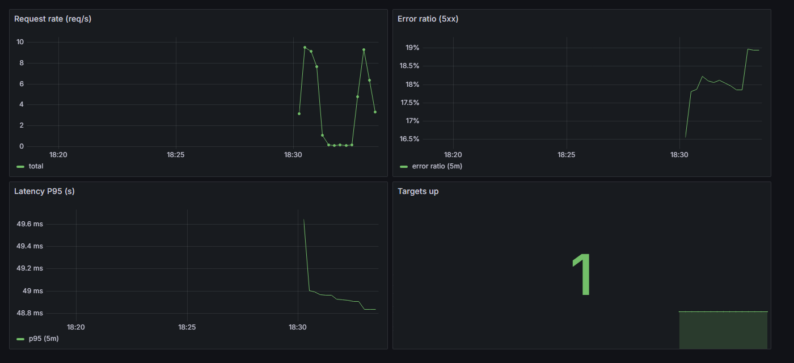

# Observability Lab

[](https://github.com/daviamarall/observability-lab/actions/workflows/ci.yml)


Stack de **observabilidade** completa, do zero, rodando com um único `docker compose up` — feita para demonstrar os fundamentos de **SRE**: medir, alertar e reagir com base em **SLI/SLO**.

> Projeto de portfólio focado em **SRE / DevOps**. O foco é o **pipeline de dados de telemetria** e a **disciplina operacional** ao redor dele.

---

## 🎯 O que este repositório demonstra

- **Instrumentação** de uma aplicação com `prometheus_client` (Counter, Histogram, Gauge)
- **Coleta** de métricas com Prometheus (scrape config, retention)
- **Alerting** com Alertmanager (rotas, agrupamento, silenciamento)
- **Regras de alerta** baseadas em **SLI/SLO** (taxa de erro e latência P95)
- **Dashboards as code** provisionados automaticamente no Grafana
- **Definição formal de SLI/SLO + error budget** (ver [`docs/SLI-SLO.md`](docs/SLI-SLO.md))
- **Runbook** de resposta a incidentes (ver [`docs/RUNBOOK.md`](docs/RUNBOOK.md))
- Ambiente 100% reproduzível via Docker Compose

## 🏗️ Arquitetura

```
                    ┌──────────────────────────────────────────────┐
                    │              docker compose                   │
                    │                                                │
  curl /work ─────▶ │  ┌────────┐   scrape   ┌────────────┐          │
                    │  │  app   │◀───────────│ Prometheus │          │
                    │  │ :8000  │  /metrics  │   :9090    │          │
                    │  └────────┘            └─────┬──────┘          │
                    │                              │ evaluates rules │
                    │                              ▼                  │
                    │                        ┌──────────────┐        │
                    │                        │ Alertmanager │        │
                    │                        │    :9093     │        │
                    │                        └──────────────┘        │
                    │                                                │
                    │  ┌──────────┐   query    ┌────────────┐        │
                    │  │ Grafana  │◀───────────│ Prometheus │        │
                    │  │  :3000   │            └────────────┘        │
                    │  └──────────┘                                  │
                    └──────────────────────────────────────────────┘
```

## 📊 Dashboard (Grafana)

Dashboard provisionado **como código**, com os SLIs do serviço (taxa de requisições, taxa de erro 5xx, latência P95 e targets up):



## 🚀 Como rodar

```bash
docker compose up --build
```

| Serviço      | URL                     | Credenciais  |
|--------------|-------------------------|--------------|
| API + /metrics | http://localhost:8000 | —            |
| Prometheus   | http://localhost:9090   | —            |
| Alertmanager | http://localhost:9093   | —            |
| Grafana      | http://localhost:3000   | admin/admin  |

### Gerar tráfego (para ver os gráficos vivos)

```bash
# 200 chamadas com ~15% de falha simulada e ~120ms de latência
for ($i=0; $i -lt 200; $i++) { curl "http://localhost:8000/work?fail=0.15&delay=0.12" }
```

## 🔌 Endpoints da aplicação

| Método | Rota        | Descrição                                             |
|--------|-------------|-------------------------------------------------------|
| GET    | `/`         | Metadados do serviço                                  |
| GET    | `/healthz`  | Liveness probe                                        |
| GET    | `/work`     | Simula trabalho; `?fail=0..1` e `?delay=segundos`     |
| GET    | `/metrics`  | Métricas no formato Prometheus                        |

## 📊 SLI / SLO (resumo)

| SLI                         | SLO alvo      | Error budget (30d) |
|-----------------------------|---------------|--------------------|
| Disponibilidade (taxa 2xx)  | 99,9%         | 43m12s             |
| Latência P95                | < 300 ms      | 5% dos períodos    |

Detalhes em [`docs/SLI-SLO.md`](docs/SLI-SLO.md).

## 🚨 Alertas configurados

| Alerta            | Condição                                           | Severidade |
|-------------------|----------------------------------------------------|------------|
| `HighErrorRate`   | taxa 5xx > 5% por 2 min                            | critical   |
| `HighLatencyP95`  | P95 > 0.3s por 5 min                               | warning    |
| `AppDown`         | `up == 0` por 1 min                                | critical   |

## 📁 Estrutura

```
observability-lab/
├── app/                     # aplicação instrumentada (FastAPI + prometheus_client)
├── prometheus/              # prometheus.yml + alerts.yml (regras SLO)
├── alertmanager/            # alertmanager.yml (rotas)
├── grafana/                 # provisionamento de datasource + dashboards (as code)
├── docs/                    # SLI-SLO.md e RUNBOOK.md
└── docker-compose.yml
```

## 🛠️ Stack

Python · FastAPI · prometheus_client · Prometheus · Alertmanager · Grafana · Docker Compose

## 📄 Licença

MIT — veja [LICENSE](LICENSE).
